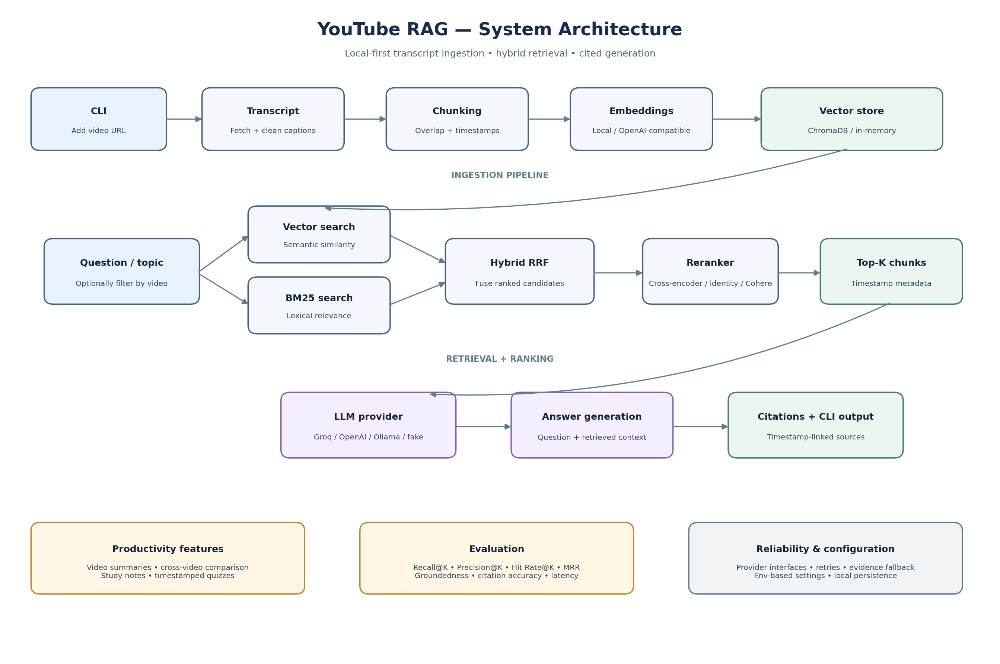

# YouTube RAG — Timestamp-Aware Video Knowledge Assistant

Turn YouTube videos into a searchable, conversational knowledge base. This Python CLI retrieves relevant moments from video transcripts and uses a language model to answer questions with timestamped source citations. It also supports topic search, summaries, cross-video comparisons, study notes and quizzes, and retrieval evaluation.

> **Built for local-first use.** The vector store and embeddings can run locally; an LLM provider can be configured separately. No website or hosted backend is required.

## What it does

- **Ingest YouTube videos:** fetch available captions, clean transcript segments, preserve video timestamps, and skip videos that are already indexed.
- **Chunk and embed transcripts:** create overlapping sentence-oriented chunks with video IDs, titles, and start/end times attached as metadata.
- **Persist a searchable library:** use ChromaDB for local persistent vector storage, or an in-memory store for tests and temporary runs.
- **Retrieve with multiple strategies:** compare semantic vector retrieval, BM25 lexical retrieval, rank-fused hybrid search, and hybrid search followed by reranking.
- **Answer with evidence:** retrieve relevant transcript chunks, pass them as context to the configured LLM, and render source citations linked to timestamps in the original video. The QA pipeline can return an insufficient-evidence response when retrieval is empty or falls below the configured relevance threshold.
- **Search by topic:** find relevant moments across the indexed library or a selected subset of videos.
- **Summarize and compare:** summarize a selected video or compare multiple videos around a question or theme.
- **Learn from videos:** generate study notes and quiz questions with source timestamps.
- **Evaluate retrieval and generation:** report Recall@K, Precision@K, Hit Rate@K, MRR, median retrieval latency, plus answer-relevance, groundedness, citation-accuracy, and median LLM latency when generation evaluation is enabled.

## Architecture



The diagram is also available as editable Mermaid source: [`docs/diagrams/architecture.mmd`](docs/diagrams/architecture.mmd).

### Ingestion path

1. The CLI accepts a YouTube URL and extracts the video ID.
2. The transcript provider fetches available caption segments; preprocessing cleans the transcript.
3. Timestamp-aware chunking creates overlapping chunks and retains each chunk's start and end times.
4. The configured embedding provider converts chunk text to vectors.
5. The vector-store abstraction persists chunks, embeddings, and metadata. A cleaned transcript copy is also written locally when possible.

### Question-answering path

1. A question is sent through the retrieval pipeline.
2. Vector search and BM25 return candidate chunks. Hybrid mode combines ranks with Reciprocal Rank Fusion (RRF), avoiding direct addition of scores that live on different scales.
3. The configured reranker selects the final top-K chunks. The default configuration uses a local sentence-transformers cross-encoder; identity and Cohere options are also implemented.
4. The LLM receives the question and retrieved context. Citations are built from the retrieved timestamp metadata and rendered as video links.
5. If there is no usable evidence or the model call fails, the app returns a controlled fallback rather than treating the answer as grounded.

## Retrieval strategies

| Strategy | How it works | Useful for |
|---|---|---|
| `vector` | Semantic similarity search over stored embeddings | Conceptual or paraphrased questions |
| `bm25` | Lexical ranking based on query-term overlap | Exact terms, names, and keywords |
| `hybrid` | Merges vector and BM25 ranks using Reciprocal Rank Fusion | Combining semantic and lexical evidence |
| `hybrid_rerank` | Hybrid candidate generation followed by a reranker | Default question-answering retrieval path |

Retrieval evaluation compares these four strategies on the same question set.

## Technology

- **Language and interface:** Python 3.11+; command-line UI with optional Rich formatting
- **Transcript acquisition:** `youtube-transcript-api`
- **Vector persistence:** ChromaDB, with an in-memory implementation for tests
- **Lexical retrieval:** BM25 via `rank-bm25`
- **Embeddings:** local `sentence-transformers`, OpenAI-compatible embeddings, or a deterministic hash embedder
- **Reranking:** sentence-transformers cross-encoder, Cohere Rerank, or identity reranking
- **LLM providers:** Groq, OpenAI-compatible API, Ollama, or a fake/offline provider used for tests and demos
- **Testing:** pytest

The default configuration in `app/config.py` sets Groq as the LLM provider, local `all-MiniLM-L6-v2` embeddings, ChromaDB storage, and cross-encoder reranking. The configured providers and model names can be changed with environment variables.

## Quick start

### 1. Clone and create an environment

```bash
git clone https://github.com/anjani24/youtube-rag.git
cd youtube-rag
python -m venv .venv
```

Activate the environment:

**macOS / Linux**
```bash
source .venv/bin/activate
```

**Windows PowerShell**
```powershell
.venv\Scripts\Activate.ps1
```

### 2. Install dependencies

```bash
python -m pip install --upgrade pip
pip install -r requirements.txt
```

For local sentence-transformer embeddings and cross-encoder reranking, `sentence-transformers` is included in the requirements. Initial model use may download model files.

### 3. Configure the LLM

Create a `.env` file in the repository root, or set the environment variables in your shell. The application reads configuration from environment variables in `app/config.py`.

Example for the default Groq LLM provider:

```dotenv
LLM_PROVIDER=groq
GROQ_API_KEY=your_groq_api_key
LLM_MODEL=openai/gpt-oss-20b
EMBEDDING_PROVIDER=local
EMBEDDING_MODEL=all-MiniLM-L6-v2
RERANKER_PROVIDER=cross_encoder
RERANKER_MODEL=cross-encoder/ms-marco-MiniLM-L-6-v2
VECTOR_STORE=chroma
CHROMA_DIR=chroma_db
```

Never commit real API keys. The repository's `.gitignore` excludes `.env` and local persisted data. The project also implements Ollama and fake LLM providers; consult `app/config.py` and `app/llm/provider.py` for the supported configuration names and required keys.

### 4. Launch the CLI

```bash
python main.py
```

The interactive menu offers:

1. Add a YouTube video
2. List indexed videos
3. Ask a question
4. Search topics
5. Summarize a video
6. Compare videos
7. Learning mode
8. Run evaluation
9. Exit

Start by adding a video that has accessible captions. Once indexed, choose **Ask a question** and select either specific videos or the whole library.

### 5. Run evaluation

```bash
python main.py evaluate
```

The command creates a sample evaluation file if one does not exist. Index at least one video before evaluating retrieval. You can edit `data/evaluation/questions.json` to add questions, expected video IDs, and keywords suited to your indexed transcripts.

### 6. Run tests

```bash
python -m pytest -q
```

The tests cover chunking, citations, evaluation, ingestion, RAG behavior, retrieval, storage, and URL handling. Tests use fixtures and can exercise the in-memory/fake components; running the real configured LLM provider may require credentials and network access.

## Configuration reference

The values below are defaults from `app/config.py`; all values can be overridden by environment variables with the matching uppercase names.

| Setting | Default | Purpose |
|---|---|---|
| `LLM_PROVIDER` | `groq` | LLM backend: `groq`, `openai`, `ollama`, or `fake` |
| `LLM_MODEL` | `openai/gpt-oss-20b` | Model name passed to the selected provider |
| `EMBEDDING_PROVIDER` | `local` | `local`, `openai`, or `hash` embeddings |
| `EMBEDDING_MODEL` | `all-MiniLM-L6-v2` | Model name for local or OpenAI-compatible embedding provider |
| `RERANKER_PROVIDER` | `cross_encoder` | `cross_encoder`, `identity`, or `cohere` |
| `RERANKER_MODEL` | `cross-encoder/ms-marco-MiniLM-L-6-v2` | Local cross-encoder model |
| `VECTOR_STORE` | `chroma` | Persistent `chroma` or in-memory `memory` store |
| `CHROMA_DIR` | `chroma_db` | Local Chroma persistence directory |
| `COLLECTION_NAME` | `youtube_knowledge` | Chroma collection name |
| `TOP_K` | `5` | Final results sent to the LLM |
| `VECTOR_TOP_K` | `15` | Vector-search candidate count |
| `BM25_TOP_K` | `15` | BM25 candidate count |
| `RERANK_TOP_K` | `5` | Results retained after reranking |
| `RRF_K` | `60` | Reciprocal Rank Fusion constant |
| `CHUNK_SIZE` | `800` | Target chunk size in characters |
| `CHUNK_OVERLAP` | `150` | Target overlap in characters |
| `MIN_RELEVANCE_SCORE` | `0.0` | Below this score, answer with insufficient evidence |
| `MAX_RETRIES` | `3` | Retry count for provider calls where supported |
| `REQUEST_TIMEOUT` | `60` | Provider request timeout in seconds |

For exact provider/key requirements and additional settings, see [`app/config.py`](app/config.py), [`app/embeddings/embedder.py`](app/embeddings/embedder.py), [`app/llm/provider.py`](app/llm/provider.py), and [`app/retrieval/reranker.py`](app/retrieval/reranker.py).

## Project structure

```text
youtube-rag/
├── app/
│   ├── chunking/       # Overlapping transcript chunks with timestamp mapping
│   ├── embeddings/     # Local, OpenAI-compatible, and hash embedders
│   ├── evaluation/     # Question sets, retrieval/generation metrics, reports
│   ├── ingestion/      # YouTube URLs, transcript fetch, cleaning, ingestion
│   ├── learning/       # Study notes and timestamped quiz generation
│   ├── llm/            # Groq, OpenAI-compatible, Ollama, and fake providers
│   ├── rag/            # QA pipeline, prompts, citations, topic search
│   ├── retrieval/      # Vector, BM25, hybrid RRF, and reranking
│   ├── storage/        # Persistent Chroma and in-memory store abstractions
│   ├── summarization/  # Video summaries
│   ├── config.py       # Environment-based configuration
│   └── utils.py        # Shared logging, retries, timestamp utilities
├── data/               # Local transcripts and evaluation questions
├── scripts/            # Supporting scripts
├── tests/              # Automated tests
├── main.py             # Interactive CLI entry point
├── requirements.txt
└── README.md
```

## Design decisions

- **Timestamp preservation is end-to-end:** transcript chunk objects and stored metadata carry start/end time fields so relevant moments can be linked back to YouTube.
- **Retrievers are interchangeable:** vector, BM25, hybrid, and reranked paths share the retrieval result interface, allowing side-by-side evaluation.
- **RRF combines ranks, not raw scores:** vector similarity and BM25 scores are on different scales; rank fusion avoids treating them as directly comparable.
- **Providers are modular:** embeddings, LLMs, rerankers, and vector storage are selected through small interfaces/factories.
- **Local-first persistence:** transcript copies and the Chroma index are stored locally; a memory store and fake LLM support tests and demos.
- **Failure paths are explicit:** invalid URLs, unavailable transcripts, empty retrieval, and provider failures are handled through structured results or fallback answers.

## Limitations and responsible use

- The application depends on the captions available for a video. Videos without accessible transcripts may not be indexable, and automatic captions can contain errors.
- Generated answers and summaries can still be incomplete or incorrect. Follow citations back to the source video, especially for important claims.
- Retrieval evaluation metrics depend on the supplied expected videos and keywords; they are useful diagnostics, not a universal benchmark.
- Local model downloads consume disk space and model inference consumes CPU/GPU resources. Hosted LLM and reranking providers may send query/context text to third-party services and may incur costs or rate limits.
- The repository is a local CLI app, not a deployed web service.

## Roadmap ideas

Potential next steps for a stronger portfolio demonstration include adding a short terminal demo recording, tracking evaluation results on a documented fixed transcript set, testing citation coverage on edge cases, and providing a reproducible benchmark comparing vector, BM25, hybrid, and reranked retrieval.

## License

Use the license file in the repository if present; otherwise, add a license before distributing the project for reuse.
